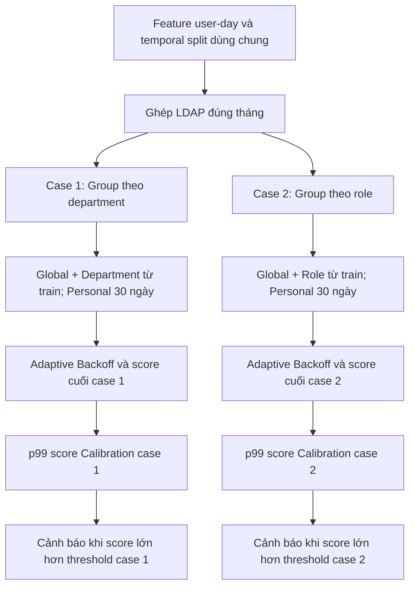

# Bản đối chiếu nghiệm thu kỹ thuật SPEC-002

Ngày kiểm tra: 2026-11-09. Phạm vi theo DL-041: chỉ kiến trúc ba tầng và hai cấu hình Department/Role. Đây là kết quả kiểm chứng kỹ thuật để người dùng review, không thay cho quyết định nghiệm thu của người dùng.

## 1. Hệ thống làm gì?

Với hoạt động của một nhân viên trong ngày, hệ thống so với toàn tổ chức, nhóm của nhân viên và lịch sử riêng 30 ngày. Mỗi tầng tạo một score; tầng có nhiều dữ liệu tham chiếu hơn nhận trọng số theo công thức đã duyệt. Các score được kết hợp thành một score cuối, sau đó so với threshold của case.

Threshold được tính sau khi hoàn thành Calibration và giữ cố định cho dữ liệu đánh giá sau đó. Department/Role là hai lựa chọn tại tầng Group; mỗi case luôn có đúng ba tầng.

## 2. Đối chiếu yêu cầu với implementation

Đường dẫn bên dưới tính từ gốc project.

| Yêu cầu | Code / cấu hình | Bằng chứng | Kết luận |
|---|---|---|---|
| Hai cấu hình riêng | configs/experiments/group_department.json và group_role.json | Overlay chỉ có extends và group_key; runner yêu cầu một case mỗi loại | Đạt |
| Global toàn tổ chức | src/itd/scoring/tiers.py: fit_baselines | Thống kê mọi dòng train; test_hand_calculation_weights_and_constant_features | Đạt |
| Group đúng Department hoặc Role | src/itd/data/ldap.py: load_monthly_groups, join_groups; tiers.py: fit_baselines | Ghép đúng tháng; test_group_members_are_distinct_and_metadata_missing_does_not_drop_rows | Đạt |
| Personal lịch sử 30 ngày | tiers.py: init_history, score_days | test_window_boundary_and_gap; test_future_invariance_day_order_and_split_continuity | Đạt |
| Chỉ dùng quá khứ để chấm ngày t | tiers.py: score_days | Chấm hết ngày t rồi cập nhật history; kiểm bất biến khi sửa tương lai | Đạt |
| Adaptive Backoff theo độ tin cậy | tiers.py: score_days | Số ngày Personal, số user riêng biệt Group; test tính tay và cold-start | Đạt |
| Final Anomaly Score | tiers.py: _score, score_days | Mean positive z, scale floor=1; tổng score có trọng số; test_one_sided_score | Đạt |
| Một threshold cuối mỗi case | src/itd/scoring/threshold.py | test_p99_and_strict_comparison; tính lại p99 từ CSV Calibration khớp artifact | Đạt |
| Chung dữ liệu, feature, split và quy tắc threshold | scripts/run_group_ablation.py: resolve_config, run_ablation | Fingerprint cấu hình chung; đọc dữ liệu chung; đối soát cùng 84.066 khóa Calibration theo đúng thứ tự | Đạt |
| Thiếu nhóm/người mới vẫn chấm được | tiers.py: score_days | test_cold_start_missing_group_and_single_user_group; fallback, không loại user-day | Đạt |
| Global/Group và threshold không học từ test | runner, tiers.py và threshold.py | test_frozen_baselines_and_threshold_ignore_future_test_changes | Đạt |
| Truy vết và không ghi đè run | scripts/run_group_ablation.py | Config, manifest/hash, baseline, history, score, threshold, môi trường; test_paired_cli_repeatability_and_artifacts | Đạt |

Các test nêu ở bảng nằm trong tests/test_tiers.py, tests/test_threshold.py và tests/test_group_ablation.py. AC-01–AC-10 của SPEC-002 được bao phủ bởi các kiểm chứng tương ứng: cấu hình/LDAP, công thức/backoff, cửa sổ/causality, frozen baseline, threshold, missing-data và tái lập/artifact.

## 3. Công thức đã nghiệm chứng

Mỗi tầng dùng trung bình phần dương của `(x−mean)/max(std,1)` trên sáu count. Hoạt động giảm không tạo đóng góp bất thường trong phiên bản này.

- n là số ngày hoạt động của Personal trong [t−30,t); wP=n/(n+7) nếu n≥2, nếu không bằng 0.
- m là số nhân viên riêng biệt của Group trong train; rG=m/(m+3) nếu nhóm hợp lệ và m≥2, nếu không bằng 0.
- wG=(1−wP)rG; wGlobal=1−wP−wG.
- Score cuối = wGlobal×sGlobal + wG×sGroup + wP×sPersonal. Tầng không dùng không tham gia tổng.

Các count là logon, logoff, device, file, email, http. Không đưa role/department hoặc cờ thiếu metadata vào vector số. Personal liên tục qua split và khi nhân viên chuyển nhóm; Global/Group giữ cố định từ train.

## 4. Kết quả kiểm tra thực tế

Toàn bộ test phần mềm: **101 passed trong 3.59 giây**. Báo cáo máy đọc được: [pytest.xml](../runs/20261109-spec002-acceptance/pytest.xml). Test dùng fixture; không chạy lại đánh giá CERT test.

Đối soát artifact run [20261109-three-tier-calibration](../runs/20261109-three-tier-calibration):

| Case | Số dòng Calibration | Threshold p99 | Cảnh báo Calibration |
|---|---:|---:|---:|
| Department | 84.066 | 0.8423588864100263 | 841 |
| Role | 84.066 | 0.8115505803240236 | 841 |

Đã kiểm từng dòng: score/trọng số hữu hạn; trọng số không âm, tổng bằng 1 trong dung sai 1e-12; cảnh báo đúng điều kiện score > threshold. Tính lại p99 linear khớp threshold lưu. Hai case cùng khóa user-day và cấu hình chung; manifest test=deferred và không có test_scores.csv trong run này. Bằng chứng và SHA-256 code/config: [verification.json](../runs/20261109-spec002-acceptance/verification.json).

Split đã duyệt: train 01–05/2010, Calibration 06–09/2010, test 10/2010–05/2011. Input train 105.171 dòng; lần chạy train/Calibration mất 40.990708 giây. Số cảnh báo Calibration là chẩn đoán trên tập đã dùng hiệu chỉnh threshold, không phải FPR hoặc hiệu quả held-out.

## 5. Review ba vòng và giới hạn

| Vòng | Kết quả |
|---|---|
| Khớp yêu cầu | Hai case đúng ba tầng; chung dữ liệu/features/split/nguyên tắc Calibration; không triển khai SPEC-003 |
| Đúng logic | Cửa sổ quá khứ, backoff, cold-start, frozen baseline và threshold được test; artifact Calibration được kiểm lại |
| Chạy được và bàn giao | 101 test qua; config chạy trực tiếp; có hướng dẫn và artifact thực tế |

**Kết luận: đạt nghiệm thu kỹ thuật trong phạm vi SPEC-002.** Không đồng nghĩa chứng minh chất lượng phát hiện đủ cho triển khai thực tế hoặc người dùng đã chính thức duyệt nghiệm thu.

Đây là mô hình thống kê sáu count; mean/std nhạy outlier. Personal cập nhật mọi quan sát sau khi chấm, kể cả ngày có cảnh báo; dữ liệu độc hại kéo dài có thể ảnh hưởng chuẩn cá nhân. Global/Group không cập nhật theo thời gian. Không có threshold riêng từng tầng; chỉ một threshold cuối mỗi case. Nhãn/lọc ngày độc hại train được chuẩn bị bên ngoài runner; cờ policy trong config là khai báo, không tự lọc dữ liệu.

Không thay thuật toán, tune tham số, sinh feature mới hay mở thêm test trong lần nghiệm thu này. Google Doc chưa được cập nhật bằng bản nghiệm thu này; chỉ tạo tài liệu local theo lựa chọn A.

## 6. Bàn giao

Người dùng review bảng §2 và giới hạn §5. Hướng dẫn vận hành: [three-tier-usage.md](three-tier-usage.md). Kết quả test nghiên cứu lần 1 và audit đã có ở [cert-test-open-1-results.md](cert-test-open-1-results.md) và [label-pipeline-audit.md](label-pipeline-audit.md); không cần chấm test lần nữa để kiểm tra chức năng hiện tại.
